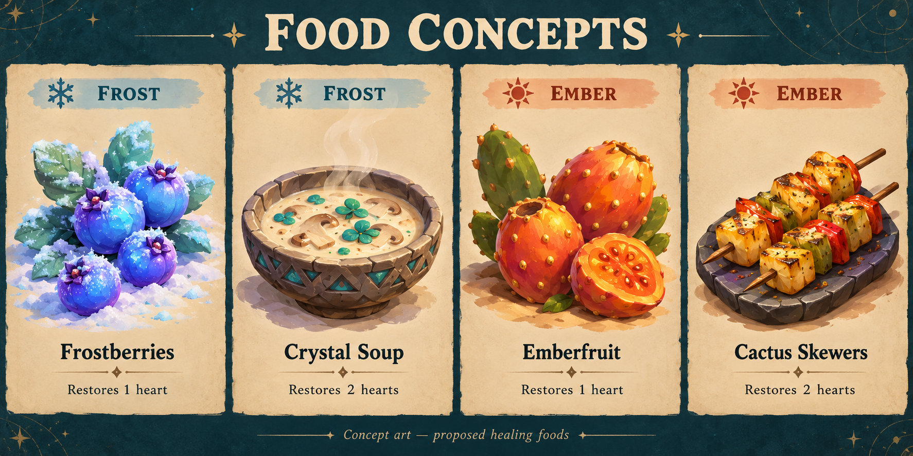

# Frost and Ember food concepts

These are concepts for review, not new inventory items in this build.

Frostberries and emberfruit are the preferred wild pickups. Soup and skewers
are recipe ideas only: prepared meals must come from an alien settlement's
cook, never appear as loose bowls or dishes in the wilderness. There are no
Earth mushrooms, peppers or other imported ingredients assumed on these worlds.

| World | Item | Proposed effect | Suggested source |
| --- | --- | --- | --- |
| Frost | Frostberries | Restore one heart | Frosted shrubs beside sheltered trails |
| Frost | Crystal Soup | Restore two hearts | Camp recipe only, using local icecap fungi and frostleaf |
| Ember | Emberfruit | Restore one heart | Prickly pear patches away from lava |
| Ember | Cactus Skewers | Restore two hearts | Camp recipe only, using emberfruit and edible sunspine pads |

Use the same half-heart units and health cap as Earth's berries/apples. Food
should remain optional, work through the existing interaction button, and only
be consumed when healing is needed. Keep silhouettes clear against snow or sand.
Soup and skewers offer local alternatives to return trips for camp healing.

The concept sheet's soup and skewers are provisional visual placeholders. Any
future implementation needs local ingredient artwork, sources and camp cooking
before those meals make sense. The two foraged fruits can work independently.
