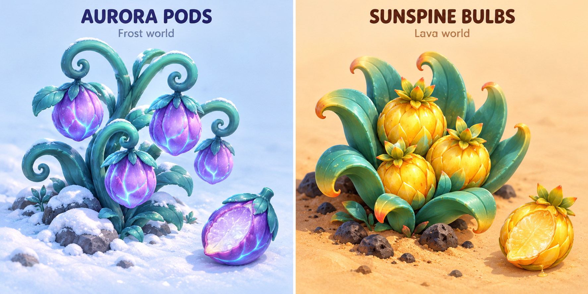

# Frost and Ember wild foods

All four approved foods are implemented as native outdoor plants with ripe and
harvested artwork, gentle foliage movement and one plant per Frost/Ember map.
They heal on approach while hurt, using Earth's existing half-heart health units
and five-heart cap. Full health leaves the fruit on the plant; menus, pause,
travel and mines prevent harvesting. Picked plants keep their positions, empty
foliage and discovery state through district, mine and rocket revisits. Earth
retains its two apple trees and two berry bushes.

| World | Food | Appearance and source | Healing |
| --- | --- | --- | --- |
| Frost | Frozen berries | Blue berry clusters on frosted shrubs beside sheltered trails | One heart |
| Frost | Aurora pods | Plump violet pods on curling alien vines, with teal leaves and faint cyan veins | Two hearts |
| Ember | Emberfruit | Orange fruit on branching alien cactus plants | One heart |
| Ember | Sunspine bulbs | Golden bulbs nestled inside fleshy teal spiral leaves | Two hearts |

All four grow naturally on their own plants and are ready to eat. They use Earth's
existing pick-and-heal interaction, half-heart units and health cap: gather only
when healing is needed, avoid consuming a plant at full health, and remember
picked plants when revisiting an area. No ingredient inventory or cooking system
is added. Keep each plant's silhouette distinct from ore deposits and rocks.

The approved mockup shows the Aurora plant on snow and the Sunspine plant on
warm volcanic sand, with detached ripe foods for their item-icon studies. The
older `frost-ember-food.png` sheet is superseded and retains the rejected meals.

## Outdoor distribution

| Plant | Outdoor maps |
| --- | --- |
| Frozen berries | Canyon Camp, Frozen Basin, Prism Pass |
| Aurora pods | Aurora Shelf, Glacier Crown |
| Emberfruit | Mesa Camp, Dune Sea, Obsidian Rise |
| Sunspine bulbs | Sunken Oasis, Redrock Arches |

Plants fit their roots to clear native snow/sand and the current walking map,
with clearance from ore, trails, mine doors, camp pads, NPCs and quest props.
Gardens reuse the district's loaded scenery; no new map downloads or plant
colliders are added. Food restores hearts; shade and antidote still handle venom.
`tests/healing_gardens.gd` checks all 15 outdoor districts, food identities,
healing amounts/cap, fog and menu protection, and no regrowth through mines or
rocket travel. `assets/food/wild_plants.png` is the production foliage atlas;
the images in this document are the approved concept references.
