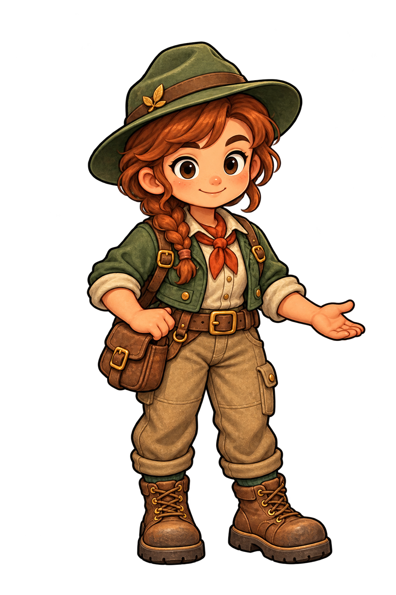
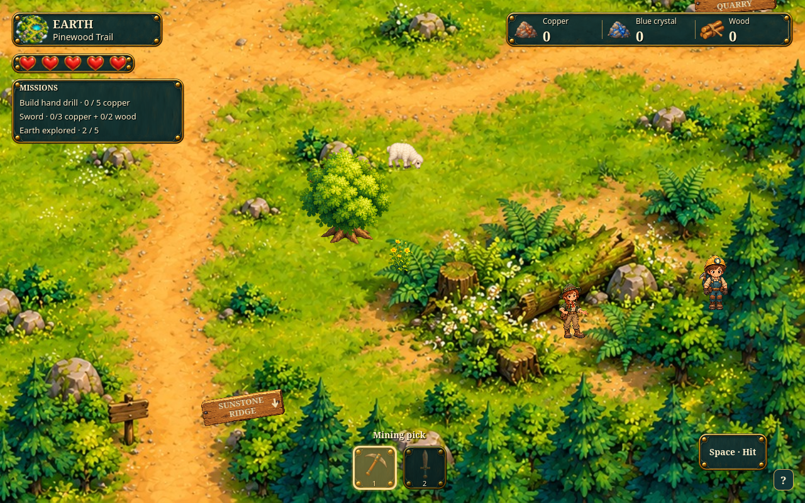
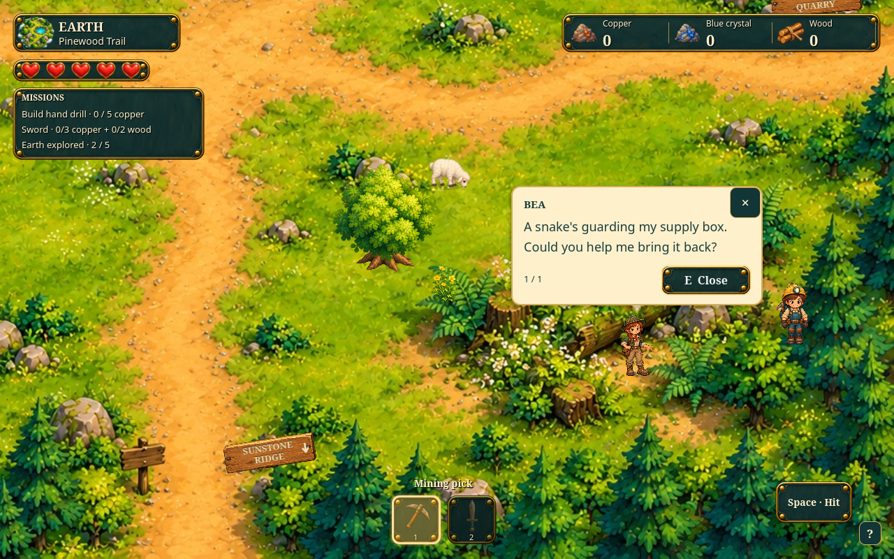
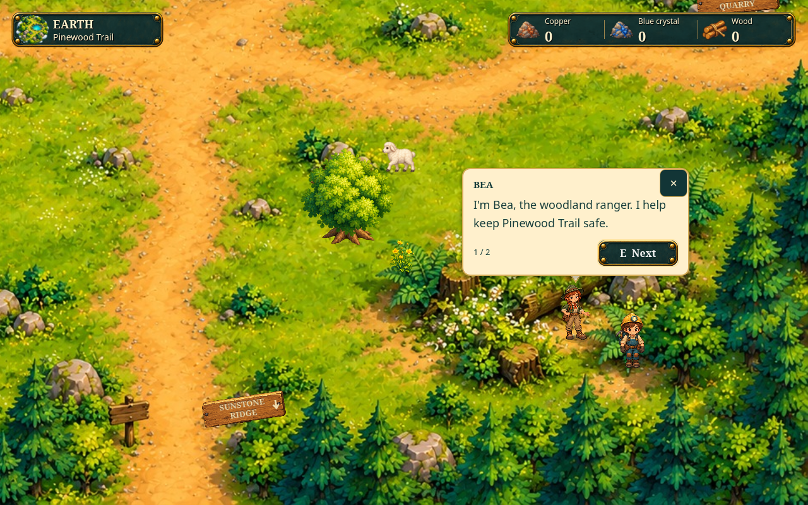
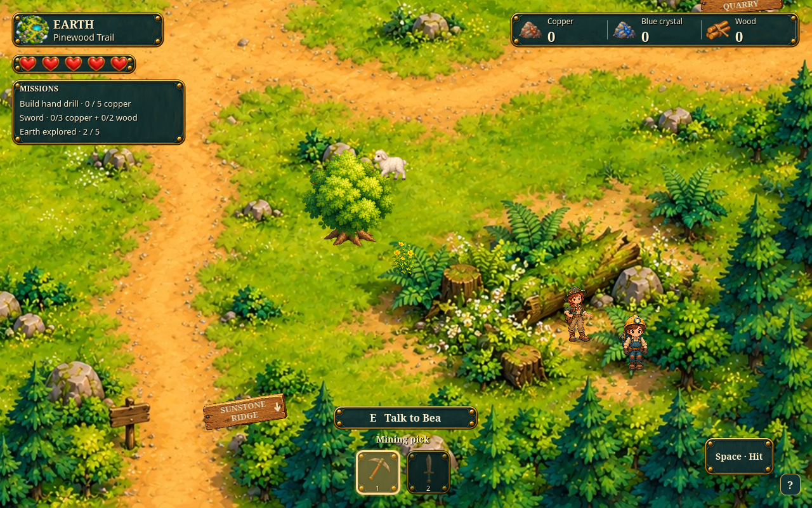

# Bea character and placement review

Character concept and proposed placement for the [Woodland Supplies mission](../../BEA_MISSION.md).
The character and revised clearing placement have been approved. The original
design screenshots remain here as reference; B04 now adds the real actor and Talk
interaction to the main game. Test with F5 → Start exploring; no separate playable
preview needs to be opened.

Bea wears a green ranger hat and jacket, rust scarf, tan trousers and a supply
satchel. Her head/body proportions follow Scout's miner artwork. The isolated
concept is source art; its large source-image dimensions do not determine her
in-game size.

The placement captures use the current main-game Pinewood scenery and HUD, with
a proposed Bea sprite and shared character bubble added for the screenshot.
Both characters use the normal camera zoom and an equal 87.45-world-unit visible
height measured from their alpha bounds. Bea now stands on the clear ground
below the southeast fallen tree, beside the small stump, where the user circled
in red. Her world foot position is `(1632, 1138)`. Scout stays to the right as a
size reference; the camera and character scale stay the same.
Fog is hidden in this screenshot arrangement to show the landmark clearly.

The [scale check](scale-check.json) records the fitted sprite heights, foot
positions and completed Pinewood transition used for these captures.

The placement images above are design mockups. B04 uses the same character art
and approved foot point for the playable actor; the supply-box mission remains
the next implementation task. The parent `docs/concepts/.gdignore` excludes these
presentation files from Godot imports/exports. The playable PNG lives separately
in `assets/npcs/bea.png`.

## B04 main-game captures

These use the production actor, greeting/advice and Talk interaction in the main
scene. Fog is hidden for the screenshots so the approved landmark is clear;
normal play retains its discovery and fog rules.

