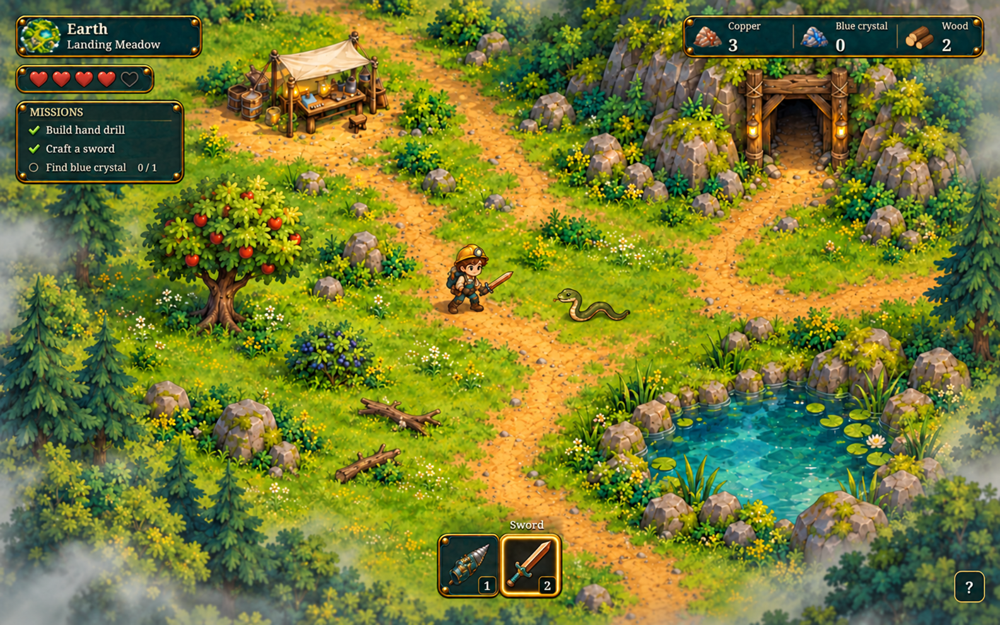
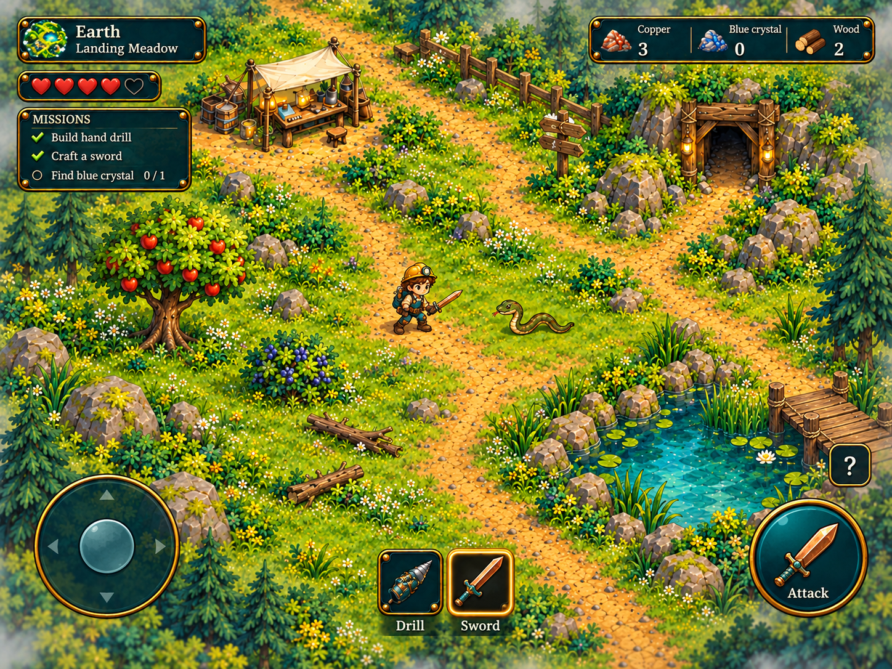
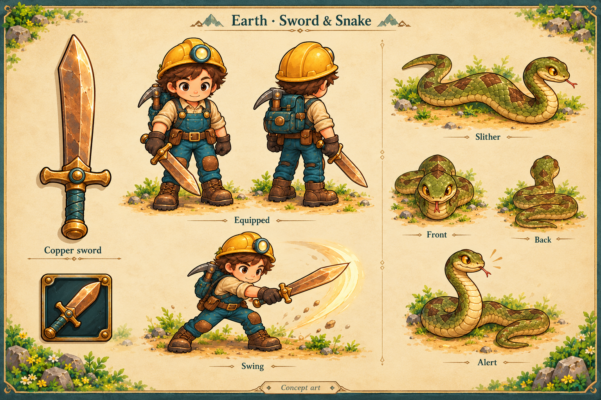
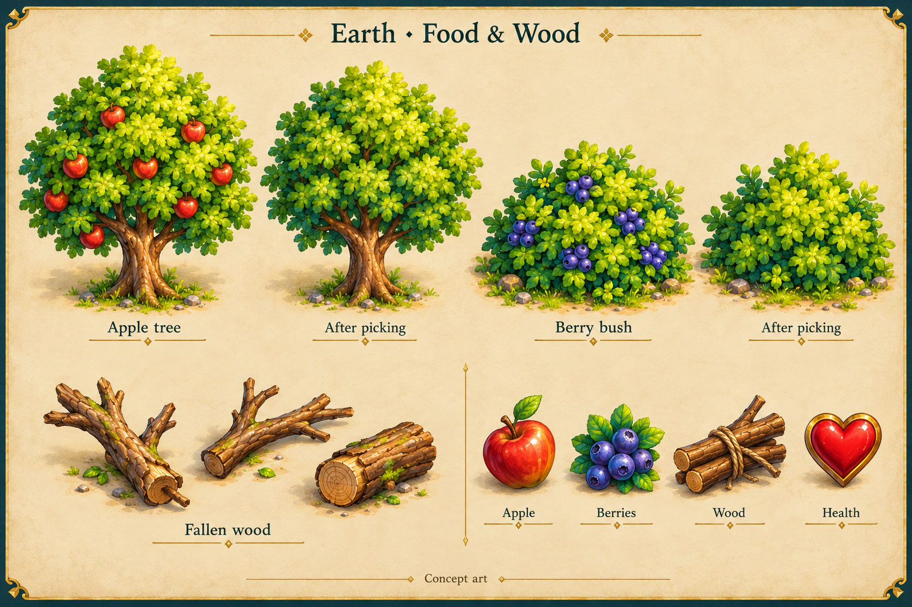

**Sunny Scout — Earth HUD and illustration concepts, version 1**

Created 19 October 2026 for Chris and Jeremy, following the [next-steps backlog](../../NEXT_STEPS.md). These concepts were approved and now inform the [Landing Meadow animation trial](../../FIRST_SCREEN_TRIAL.md). The production trial uses straight sword jabs rather than the sweeping pose shown on the original concept sheet.

The direction keeps the existing painted scenery, miner outfit, teal panels, brass edges and cream lettering. Health sits beneath the location plaque, missions have their own compact brass panel, materials remain at top right, and the drill/sword equipment slots sit at bottom centre.

**1. Desktop HUD**

The sample is a later Earth encounter with the sword selected. It shows four of five hearts, both crafting missions complete, and the blue-crystal objective active. These counts illustrate HUD states; they are not new starting inventory or approved balance values. The location is Landing Meadow, with its camp, mine and pond used as composition references. Scenery and placement are illustrative, not a proposed map replacement.

**2. iPad landscape HUD**

The touch version separates movement, equipment selection and attacking. Its buttons have larger targets, the equipment slots use labels instead of number keys, and help stays away from the attack button. This is a layout concept; final sizes, camera framing and finger reach still need checking in Godot and on an iPad.

**3. Sword, equipped character and snake**

The first sword uses a copper/bronze blade, teal-wrapped wooden grip and brass details to match the existing tools. The sheet shows how it could look on Scout, including a swing. The Earth snake uses olive scales, a warm pale belly and brown markings. Front, rear, slithering and alert views establish a consistent directional design for later animation.

**4. Food plants, wood and pickup icons**

Healthy foliage remains after harvesting, while the fruit disappears. The fallen branches/logs offer a simple first wood source. The apple, berries, wood bundle and heart establish readable icon shapes. Healing amounts and crafting costs remain open.

**Review and next implementation step**

Review the HUD scale and placement, the sword shape, snake appearance, and food/wood artwork together. After that review, the next implementation task is a functional equipment bar and health/mission layout in the existing Godot UI. Health, crafting and combat behaviour can then be added in the small steps listed in the backlog.

The illustrations are presentation sheets, rather than finished sprite atlases. Implementation will need separate transparent sprites, aligned pivots, consistent front/back/side animation frames, and fitted weapon poses in both existing outfits. Interactive plants will use separate fruit/foliage layers so harvesting and subtle wind can preserve the tree or bush silhouette.

The original generated PNGs are preserved in the working environment. These copies are kept under `docs/concepts/`; the parent `.gdignore` prevents the presentation sheets being imported into game exports. Separate production atlases for the first-screen trial live in `assets/trial/`.
