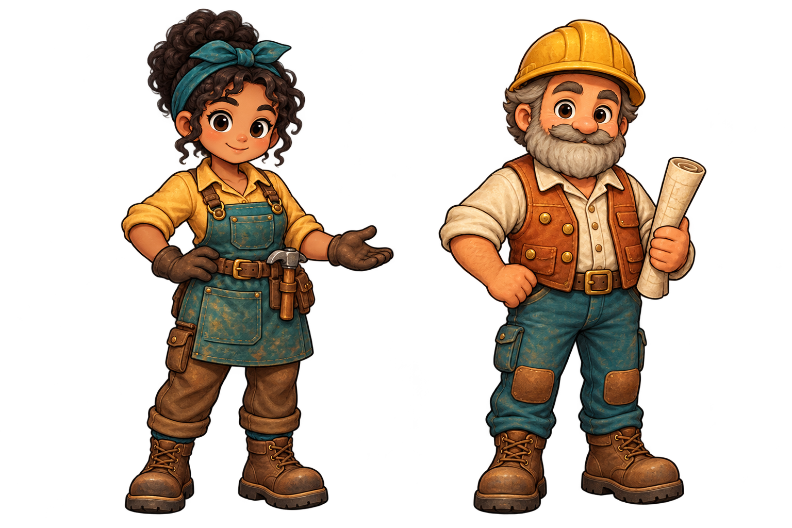
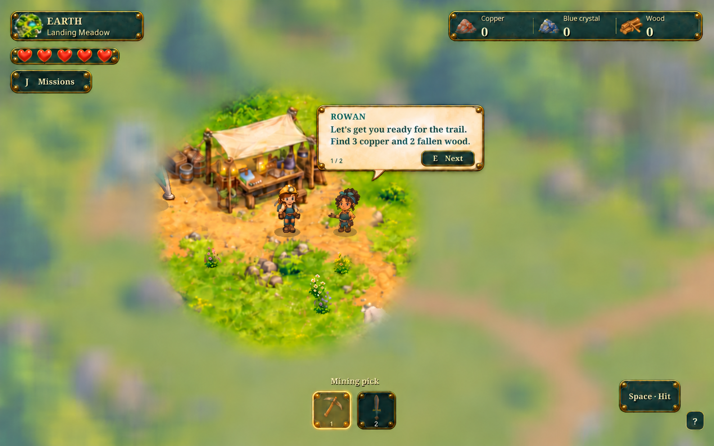

# Earth character and dialogue concepts

Initial concepts prepared 20 October 2026 for the [Earth NPC and mission tasks](../../EARTH_STORY.md). Develop and playtest one character's mission at a time, starting with Rowan at camp.

## Rowan and Otis character exploration

Rowan is on the left; Otis is on the right. The warm painted style, teal clothing, leather and brass details follow Scout's existing illustration style. These are initial character concepts. Otis's design is exploratory; his placement and mission belong to his later task.

All human characters must use Scout's scale: matching visible head-to-foot height and overall head/body proportions at the same camera zoom. Check each character alongside Scout in the landmark mockup and again against the fitted production sprite bounds. Source image dimensions and transparent margins do not establish character size.

Production work will fit each approved character to that scale and the game's foot anchors, add the required idle/interaction presentation and verify that it remains distinguishable from Scout at normal camera zoom. This sheet is not a finished animation atlas.

## Rowan at camp

The proposed dialogue is anchored above Rowan, with an explicit Next action. The large bottom instruction banner is removed. The mission list is available through a compact Missions button; health, resources and equipment keep their existing roles. The camp concept has been revised to reduce Rowan's oversized appearance and bring her into Scout's scale. Exact matching of visible sprite bounds is required in the production placement task.

This image is an AI-edited concept using the existing camp screenshot and the character exploration. Placement, text size, aspect ratio and artwork are illustrative, not a pixel-exact capture from implemented gameplay. The original Godot scene, scenery and camera remain the implementation source. Touch layout, bubble edge fitting and final NPC position need checking in the playable Rowan task.

## First mission

**Ready for the Trail:** gather 3 copper and 2 fallen wood, craft the existing copper sword at camp, and receive Rowan's acknowledgement and introduction to Bea. The complete dialogue and acceptance checks are in [Rowan tasks](../../EARTH_STORY.md#rowan-tasks).

The copies here preserve the initial concepts with the project. The parent `docs/concepts/.gdignore` keeps presentation artwork out of Godot imports and game exports. No gameplay changes are included in this concept step.
